# 🎞️ Ansible-homemedia 
[](https://lbesson.mit-license.org/)

Ansible playbook to install a private media server. Goal was to provide a reasonably light, maintainable, automated and easy to setup solution with sensible defaults. It assumes every application is served through dedicated subdomains so have your DNS properly setup.

### Features

* HTTPS Reverse proxy, authentification, authorization and apps portal through [Caddy](https://caddyserver.com/) with preconfigured secured routes. 
* Automatic updates of non major versions for SemVer containers with [What's up Docker](https://fmartinou.github.io/whats-up-docker/#/). By default, it cleans up old images and updates everyday at 4 A.M.
* Automatic firewall configuration and secure SSH daemon setup
* Intrusion detection and prevention with [CrowdSec](https://www.crowdsec.net/) — monitors SSH and Caddy access logs, bans malicious IPs at the firewall level (including Docker ports via `DOCKER-USER` chain), with community blocklists and automatic minor/patch updates
* Monitoring of Docker using [Portainer](https://www.portainer.io)
* Full use of the *Arr stack and [Deluge](https://deluge-torrent.org) to manage the downloads and subtitles.
* Proper setup of the filesystem and permissions to enable hardlinks and atomic moves
* Streaming and organization of your medias using [Jellyfin](https://jellyfin.org), exposed outside Caddy security for WebOS client compatibility
* Automated encrypted backups to [Backblaze B2](https://www.backblaze.com/cloud-storage) with [Rustic](https://rustic.cli.rs/) — daily scheduled backups of Docker container configs via systemd timer, with retention policy (7 daily, 2 weekly) and automatic pruning

### Optionals

These are not enabled by default, but you can change that by editing the ansible `group_vars/all/vars.yml` file prior to starting the playbook.

* Multi-factor authentication (MFA) upon auth portal login using [Caddy security plugin](https://authp.github.io/docs/authenticate/mfa). On first auth portal launch it'll ask you to setup MFA.
* [Flaresolverr](https://github.com/FlareSolverr/FlareSolverr) to avoid Cloudflare's challenges on specific trackers. Prowlarr can natively integrate with it.

## ⛩️ Architecture



## ⚙️ Usage 

1) Replace the placeholders in the hosts.example inventory file to use your server, SSH user. Then rename it to `hosts`
2) Replace the placeholders in `group_vars/all/vars.yml` to match your setup
3) Set up your secrets with Ansible Vault (see [Secrets management](#-secrets-management) below)
4) Run the playbook `ansible-playbook homemedia-setup.yml -K --ask-vault-pass`
5) SSH to your server and run `docker logs caddy` to grab default login and password ([see bottom page](https://authp.github.io/docs/authenticate/local/local)) for the Caddy portal. Go to your domain to login, change password and go to `portainer.{domain.com}` to make sure everything is up and running.
6) Jellyfin's startup wizard is automatically completed by the playbook (admin user, locale, remote access). You can access Jellyfin at `jellyfin.{domain.com}` and map your `/homemedia/medias` media libraries as you want.
7) Configure Deluge and the *Arr stack with the help of [Profilarr](https://github.com/Dictionarry-Hub/profilarr)
   > ⚠️ After first start, go to Deluge → Preferences → Network and:
   > - Uncheck "Use random port"
   > - Set the incoming port to **6881** (container-internal port — Docker handles the translation to 51413 on the host side)
   > - Leave outgoing ports at 0/0

## 🔐 Secrets management

Sensitive credentials (GitHub token for the LinuxServer registry, CrowdSec enrollment key, Rustic backup password and Backblaze B2 keys) are managed with **[Ansible Vault](https://docs.ansible.com/ansible/latest/vault_guide/index.html)**, which is bundled with Ansible — no extra installation needed.

When you get enrolled in the playbook, make sure to restart Crowdsec.

### First-time setup

```bash
# 1. Copy the example vault file
cp group_vars/all/vault.yml.example group_vars/all/vault.yml

# 2. Fill in your secrets (GitHub token & username for lscr.io)
$EDITOR group_vars/all/vault.yml

# 3. Encrypt it
ansible-vault encrypt group_vars/all/vault.yml
```

The unencrypted `group_vars/all/vault.yml` is listed in `.gitignore` as a safeguard.

### Running the playbook

```bash
ansible-playbook homemedia-setup.yml -K --ask-vault-pass
```

### Avoiding the password prompt (optional)

Store your vault password in a local file and reference it in `ansible.cfg`:

```bash
echo "your_vault_password" > ~/.ansible_vault_pass
chmod 600 ~/.ansible_vault_pass
```

Then add to `ansible.cfg`:
```ini
vault_password_file = ~/.ansible_vault_pass
```

You can then run the playbook without `--ask-vault-pass`.

### Editing secrets later

```bash
ansible-vault edit group_vars/all/vault.yml
```

## 🤔 FAQ

### Why is there no VPN ?

Because I don't need it, but one could probably add it easily. Just add and configure a new OpenVPN container in `docker-compose.yml`, route the approriate traffic through it and that's probably it ? You could also add an Ansible VPN role to help you with the setup of the container as well. PR welcome if you can make it optional and non default.

### How do backups work exactly ?

Backups are handled by [Rustic](https://rustic.cli.rs/), a fast and encrypted backup tool compatible with [restic](https://restic.net/), running as a Docker container and storing data on [Backblaze B2](https://www.backblaze.com/cloud-storage).

**Setup — Backblaze B2:**

1. Create a [Backblaze account](https://www.backblaze.com/sign-up/cloud-storage) and a B2 bucket (private, with default settings)
2. Go to **App Keys** on [secure.backblaze.com/b2_buckets.html](https://secure.backblaze.com/b2_buckets.html) and create a new application key **restricted to your bucket**
3. Note the `applicationKeyId` and `applicationKey` (shown only once) and set the following variables in your vault:
   - `vault_rustic_repo_password` — a strong password to encrypt your backups (keep it safe, you **cannot** recover backups without it)
   - `vault_rustic_b2_application_key_id` — the `applicationKeyId` from step 2
   - `vault_rustic_b2_application_key` — the `applicationKey` from step 2
4. Set `rustic_b2_bucket` and `rustic_b2_bucket_id` in `group_vars/all/vars.yml`

**How it runs:**

- A systemd timer triggers daily at 3 AM (configurable via `rustic_backup_schedule`)
- The systemd service stops the *Arr stack containers, runs `docker compose up rustic` (backup + prune), then restarts them — the *Arr containers are restarted even if the backup fails
- One snapshot group is created: `arr-stack` (Sonarr, Radarr, Prowlarr, Bazarr, Profilarr configs)
- Retention: 7 daily + 2 weekly snapshots, with automatic pruning
- Backup logs are visible in Portainer (container stays in Exited state)

**Manual operations:**

```bash
# Trigger a backup manually
sudo systemctl start rustic-backup.service

# Check backup status
sudo journalctl -u rustic-backup.service --no-pager -n 50

# List snapshots
docker compose -f /etc/docker/docker-compose.yml run --rm --entrypoint /rustic rustic -P docker-configs snapshots

# Restore a snapshot (replace SNAPSHOT_ID)
docker compose -f /etc/docker/docker-compose.yml run --rm --entrypoint /rustic rustic -P docker-configs restore SNAPSHOT_ID
```

> **Note:** The `rustic` role deploys configuration, scripts and systemd units. The backup timer only fires at the scheduled time (default 3 AM), so the `compose` role — which deploys the docker-compose file — just needs to run before the first timer trigger.

### Can other people access my applications ?

Jellyfin is accessible without going through the Caddy auth portal (for WebOS client compatibility), but it has its own authentication. All other applications are protected behind the Caddy security portal with a single admin user. If you need a request system you can enable Overseerr.

### I have a problem with setting up XYZ application !

Kindly RTFM.

### I already have an existing enviromnent, can I use this ?

Possible but not advised because this playbook was made for running on a fresh Ubuntu install. You need to watch Ansible and Docker versions as well as having a user who can write in `/` (or change `root_dir`). The playbook do use newish syntax, so Ansible >= 2.5 for the controller should suffice. For docker and compose, it is automatically installed by the playbook. However if you already have it then disable the `docker` role. Know the playbook assumes at least Compose V2, so if you're running older versions you should add back the hyphens in the `compose` role tasks. In addition be wary of the firewall and filesystem role, you may have to tweak a few things. YMMV because I haven't tested any of this, but you could using the `Vagrantfile`.

### Can I get a wildcard certificate ?

Not out of the box because that would force me to take into account everyone's DNS provider. Good news is that you can do it yourself [fairly easily](https://caddyserver.com/docs/caddyfile/patterns#wildcard-certificates) modifying Caddy's Dockerfile and Caddyfile.


## 📝 Testing

There's a `Vagrantfile` available if you'd like to contribute something or just mess around in a headless system. Just make sure you have [Vagrant](https://www.vagrantup.com/) installed as well as a provider (VirtualBox recommended). Then clone the repository and run `vagrant up` in the root directory. This will run the playbook without any of the opt-ins against a local VM in which you can `vagrant ssh` to snoop around after if you want.
